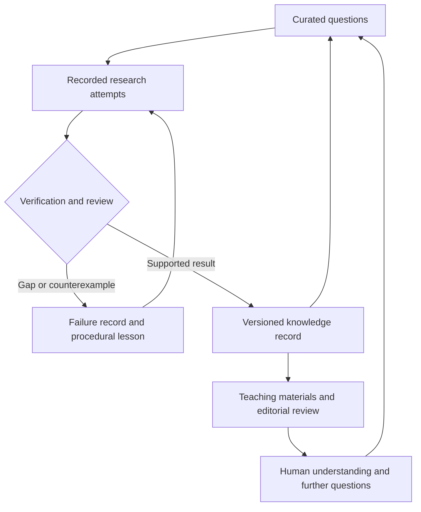

# Atlas Open Mathematics

**Investigate carefully. Preserve what is learned. Make it teachable.**

Atlas Open Mathematics is a public research and learning project directed by Albert Tan. Its purpose is to help people and AI agents investigate mathematical questions, check their work, preserve useful lessons and make those lessons available to others.

The Millennium Prize Problems give the programme long-term research directions. Every useful intermediate contribution matters: a precise statement, a reproducible counterexample, a verified supporting result, a corrected method or an explanation that helps another person understand.

## Start with a reproducible experiment

With Python 3.10 or later:

```sh
git clone https://github.com/Albertito-AI/atlas-open-mathematics.git
cd atlas-open-mathematics
python -m unittest discover -s tests -v
python -m atlas_math demo --output runs/local --seed 7
python scripts/opsbook_bridge.py --output runs/opsbook
python scripts/validate_repository.py
```

The first pilot uses exact rational arithmetic to solve small systems of linear equations. A deliberately flawed procedure and a corrected solver are checked against the equations. The run records the attempted answers, verification results and a teaching lesson. Its output includes `report.json`, `attempts.jsonl` and `lesson.md`.

The Opsbook bridge exercises the procedural-memory connection. Its outputs identify the upstream version, cases and promotion result. The repository validator checks the committed project records and documentation.

This is a scripted experiment using established mathematics. It demonstrates a research record and a procedure for checking answers. It does not demonstrate live language-model learning or a new mathematical discovery. The generated exercises are public practice material, so they cannot serve as a confidential assessment set.

## The research and teaching cycle



Every claim has three distinct attributes: what has been checked, whether it is new, and whether it has been published. These attributes cannot be inferred from one another. A checked computation may illustrate a known theorem. A promising conjecture may still be false. An accurate account of an unsuccessful method may be valuable teaching material.

Read the [research protocol](docs/RESEARCH_PROTOCOL.md) before submitting an attempt and the [verification record](docs/VERIFICATION.md) before interpreting results.

To create a fresh supported instance and check an independently supplied answer:

```sh
python -m atlas_math generate --seed 31 --output case-31.json
python -m atlas_math verify --case case-31.json --candidate candidate.json
```

The verifier accepts structured mathematical data. It does not run commands supplied by a contributor. Candidate formats and a complete example appear in the [research protocol](docs/RESEARCH_PROTOCOL.md#supported-pilot-submissions).

## What the project connects

| Component | Contribution |
| --- | --- |
| [Atlas Opsbook](https://github.com/Albertito-AI/atlas-opsbook) | Versioned procedural memory, evaluation of proposed rules and rollback. |
| Mathematical checks | Exact arithmetic and explicit certificates in the Python pilot, plus a separate [elementary Lean proof pilot](formal/README.md). |
| [RegNav Source Watch](https://github.com/Albertito-AI/regnav-source-watch) | An existing design for tracking changes in evidence and its relationships to claims. A mathematical adapter is a development task. |
| [CommCode](https://github.com/Albertito-AI/CommCode) | An existing controlled editing and checking workflow that can support future proof development. It is an optional integration. |
| Atlas Agent School | A curriculum design informing selected public educational resources. Its private institutional records are outside this repository. |
| [The Human Question](https://thehumanquestionjournal.com/) | A possible editorial home for selected accounts of reasoning, discovery and human learning, under its ordinary assessment process. |

The [architecture](docs/ARCHITECTURE.md) distinguishes implemented components from future integrations. Instructions retained by Opsbook change the context and procedures supplied to a subsequent agent. They do not by themselves retrain the underlying model.

The Lean pilot checks four elementary statements about a particular family of integer equations. All four passed a local Lean 4.24.0 kernel check and axiom audit on 9 November 2026; the [recorded evidence](formal/evidence/2026-11-09.json) identifies the precise source and environment. It does not prove the correctness of the Python implementation or a Millennium conjecture. Remote CI status is recorded separately by GitHub Actions.

## Take part

You can contribute a checked correction, a problem statement with sources, a reproducible experiment, an independent verification, a better explanation or a translation for which you hold the necessary rights.

- [Contribution guide](CONTRIBUTING.md)
- [Instructions for agents](AGENTS.md)
- [Millennium research map](docs/MILLENNIUM.md)
- [Teaching and transfer](docs/TEACHING.md)
- [Journal handoff](docs/JOURNAL_HANDOFF.md)

Problems are selected for mathematical significance and tractability. Generating many exercises, submitting many attempts or receiving agreement from several agents does not establish progress. We seek independently reproducible results and evidence that useful knowledge transfers to unfamiliar tasks and new readers.

## Resources and continuity

The initial project requires no paid model account. Local demonstrations and tests use Python's standard library. Work must stop when its authorised resources are exhausted. No contributor is asked to purchase compute or supply credentials.

Scheduled checks and any research workers operate in bounded runs, retaining checkpoints for later work. A configured schedule is not evidence that research occurred. Completed runs must leave inspectable outputs, and live model use must identify its provider, model, resource use and limitations.

The [continuing research configuration](docs/AUTOMATION.md) records the daily practice workflow and the owner-managed research task's integration with Atlas Flexible Workflow 1.2. The research task retains a daily flexible morning schedule, follows current priorities and protected duties, and preserves exact-version checkpoints between bounded iterations. Each contribution has one accountable owner; only one non-incident engineering slice is active within the coordinated programme.

Research, recorded outcomes and teaching remain the priority. Useful public results are handed to the existing GitHub Adoption, Daily Website Resource Refresh and Website Care and Reach lanes with evidence and source versions. The designated publisher handles website changes. The first [agent-authored investigation](research/agent-attempts/0001/record.md) has a [teaching companion](lessons/001-domain-matters.md).

Public material remains available under its stated licences. Access to additional private library material is considered through individual enquiries, case by case. Pricing and access administration are separate work and do not hold up research or permitted teaching.

## Rights and responsibility

Original code is distributed under the [MIT licence](LICENSE). Original educational content is distributed under [CC BY 4.0](LICENSE-CONTENT.md), except where a file states otherwise. Preserve third-party attribution and licence notices. Journal articles retain their separately agreed licences.

Albert Tan directs the project. Contributors remain responsible for their claims and must disclose material AI assistance. Mathematical review and journal decisions require appropriately qualified, independent people. No result in this repository is presented as an accepted solution to a Millennium Prize Problem.
