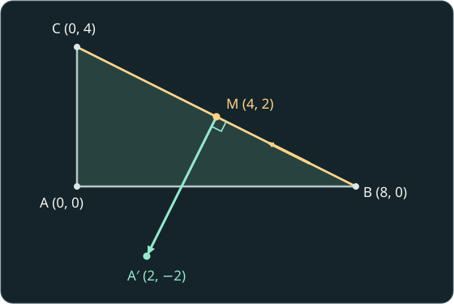

# The Three-Turn Triangle

**Geometry · Summit · Untimed**

Move three side midpoints at right angles to their sides. Can a third move restore the shape of every starting triangle?

[Try this problem](https://alberttansinhon.com/math-arcade/olympiad/#three-turn-triangle) · [Play on GitHub Pages](https://albertito-ai.github.io/Albertito-AI/math-arcade/olympiad/#three-turn-triangle) · [Proof collection](../README.md)

## Problem

Start with any labelled, noncollinear triangle ABC in the plane. A pass has a real setting s. To construct A′, start at the midpoint of BC, turn the arrow from B to C anticlockwise through 90°, multiply that arrow by s, and add it to the midpoint. Construct B′ from the arrow from C to A and C′ from the arrow from A to B in the same way. A negative setting reverses the turned arrow. Keep these cyclic labels on every pass, even if the orientation changes. A zero-length arrow contributes zero displacement.

Use settings 1/2, 1/6 and t in that order, always working on the latest triple. Let G be the centroid of the original triangle. Prove that every pass preserves G. Find the unique real t for which, for every starting triangle, the three final arrows from G are all the same scalar multiple r of their corresponding original arrows from G. Determine r and prove the uniqueness of t.

Now replace the first two settings by any real numbers a and b. Determine exactly when there is one possible third setting, when there is none, and when every third setting works. Allow r = 0 in this classification, meaning that all three final vertices coincide at G.

First pass at setting one half. A is at (0,0), B at (8,0) and C at (0,4). From the midpoint M at (4,2), a perpendicular arrow ends at A′ at (2,−2). The arrow on BC points from B towards C.

## Staged hints

1. The three directed side arrows form a closed walk. Add the three midpoint positions and then add the three perpendicular displacements.

2. Work from G as origin. If u, v and w are the vertex vectors, their sum vanishes. The midpoint opposite u therefore has vector −u/2. Use K from the second checkpoint to write one whole pass as a single operation.

3. Once K² is known, two passes act as a multiple of the identity plus a multiple of K. Multiply by the third pass and look for the coefficient of K.

4. For necessity, try the illustrated right triangle. Its arrow from G to A is parallel to (2,1), while the perpendicular to BC is parallel to (1,2). A nonzero multiple of the second direction cannot be absorbed into a multiple of the first.

## Checkpoints and answers

### Checkpoint 1

In the illustrated triangle let A = (0,0), B = (8,0), C = (0,4). Reverse the pictured setting to s = −1/2. What is the new y-coordinate of A′?

**Answer.** 6

The arrow from B to C is (−8,4). Its anticlockwise quarter-turn is (−4,−8). Subtract half of that vector from the midpoint (4,2) to reach (6,6).

### Checkpoint 2

Write J for the anticlockwise quarter-turn. For vectors u + v + w = 0 define K(u,v,w) = (J(w−v), J(u−w), J(v−u)). Applying K twice gives m times the original triple. What integer is m?

**Answer.** 3

The first component after two applications is J(J(v−u) − J(u−w)) = −v + 2u − w = 3u. Cycling the letters gives the other two components.

### Checkpoint 3

Use the setting that works after 1/2 and 1/6. If the original distance GA is 60 units, how far is the final vertex with label A from G?

**Answer.** 5

The three passes scale each position vector from G by 1/12, so a distance of 60 becomes 5.

## Worked proof

### 1. Follow the centroid

Write J for the anticlockwise quarter-turn of a vector, so J is linear and J² sends x to −x. The three side midpoints sum, as position vectors, to A + B + C. The sum of the three added arrows is sJ((C−B) + (A−C) + (B−A)) = 0. The average of the new positions is therefore G on every pass.

### 2. Turn the side differences twice

Place the origin at G and write X = (u,v,w) for the centred vertex vectors. Then u + v + w = 0. The midpoint opposite u is −u/2. With KX = (J(w−v), J(u−w), J(v−u)), a pass sends X to TₛX = (−I/2 + sK)X, where I leaves X fixed. The components of KX sum to zero, so the same formula applies again. The first component of K²X is J(J(v−u) − J(u−w)) = 2u − v − w = 3u. The other components are 3v and 3w by cyclic relabelling. Hence K² = 3I on centred triples.

### 3. Find the third setting

The passes with settings 1/2 and 1/6 together give (−I/2 + K/6)(−I/2 + K/2) = I/2 − K/3. After the third pass the operation is (−1/4 − t)I + (1/6 + t/2)K. Taking t = −1/3 cancels the K term. The coefficient of I becomes 1/12, so each final vertex lies one twelfth of the way from G to its original vertex.

### 4. Prove that cancellation is necessary

Use A = (0,0), B = (8,0), C = (0,4). Here G = (8/3,4/3), so u = (−8/3,−4/3), while the first component of KX is J(C−B) = (−4,−8). These two vectors are not parallel. If an operation αI + βK scales the arrows from G for every starting triangle, its first component on this example must be parallel to u or zero. This forces β = 0. In particular the setting −1/3 found above is unique.

### 5. Classify all first and second settings

For settings a and b, the first two passes give (1/4 + 3ab)I − ((a+b)/2)K. After setting t, the coefficient of K is (a+b + t(1+12ab))/4. The preceding triangle shows that it must vanish, and its vanishing is sufficient. If 1+12ab ≠ 0, the unique setting is t = −(a+b)/(1+12ab). If 1+12ab = 0 and a+b ≠ 0, there is no setting. If both are zero, every t works. In the last case the first two passes already give the zero operation, so every vertex has reached G before the third pass.

## Proof rubric

- Show that the three added arrows sum to zero and that the three midpoint positions have the original centroid.

- Represent a pass on centred vectors and prove the identity K² = 3I, or give a geometric argument with the same consequence.

- Derive t = −1/3 and r = 1/12, and establish why no other third setting works for every triangle.

- Give the full classification for arbitrary a and b, including both possibilities when 1+12ab vanishes.

## Transfer exercise

A machine has first settings 1 and 2. Write its unique restoring setting as a reduced fraction with positive denominator. What is that denominator?

**Answer.** 25

The equation is 3 + 25t = 0, so t = −3/25. Since 3 and 25 are coprime, the denominator is 25.

## Application: Will a map icon fit its printed box?

A designer builds a triangular map icon by applying the problem’s three midpoint passes. The original right triangle has horizontal and vertical legs of 120 mm and 90 mm. The finished icon must keep the same orientation and exactly fill a 10 mm by 7.5 mm box.

**Decision question.** After settings 1/2 and 1/6, which signed third setting should the designer use? Predict the final length of the sloping edge before measuring it.

### Worked model

Choose −1/3. The proof gives a scale of +1/12 about the original centroid. Every edge vector keeps its direction and becomes one twelfth as long. The legs become 10 mm and 7.5 mm, which gives the required bounding box.

The original sloping edge measures 150 mm by Pythagoras. Its predicted final length is 12.5 mm. The centroid also stays fixed, so it gives the designer a second check on placement.

**Model limits.** The dimensions describe the triangle’s vertex positions. A thick outline can extend beyond them, and rounding after each pass can move the final vertices.

**Try the model.** Draw the three passes on graph paper or in a drawing tool, retaining the cyclic labels. Measure the final three sides and the shift of the centroid. Repeat with a scalene triangle of your own and compare each measured ratio with 1/12.

## Further investigation

Keep the cyclic labels but replace the anticlockwise 90° turn in every pass by 60°. First test settings 1/2 and 1/6 on a non-equilateral triangle. Can any real third setting restore every labelled triangle up to a real scaling about its centroid? Explain whether a single test triangle can establish or refute your claim.

## Provenance and verification

Atlas Open Mathematics, directed by Albert Tan Sin Hon. Prepared with AI assistance. These exercises were prepared for this programme using established mathematics. The collection makes no claim of first discovery or official contest provenance.

Designed for the Atlas Math Olympiad.

The worked arguments support the general conclusions. The executable checks provide separate evidence for specified finite cases. The challenge bands are editorial judgements and have not been calibrated against human contest performance. [Reproduce the checks and inspect their scope](../README.md#verification).

Edition 1.0.0, 2026-11-28. [Edition DOI](https://doi.org/10.5281/zenodo.24620475) · [Project educational licence](../../../LICENSE-CONTENT.md) · [Code licence](../../../LICENSE)
